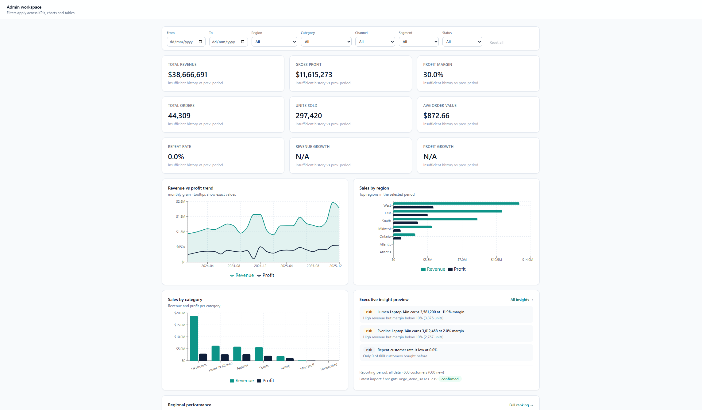
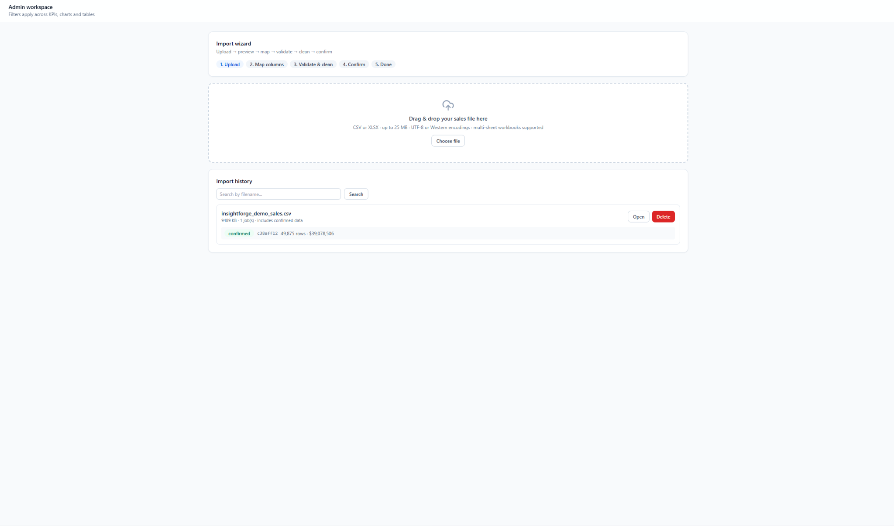
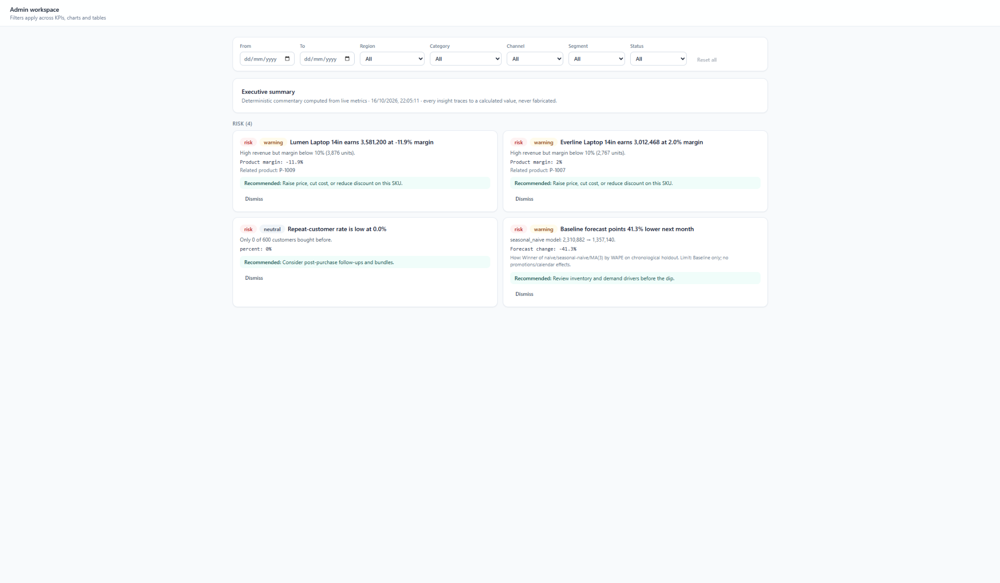
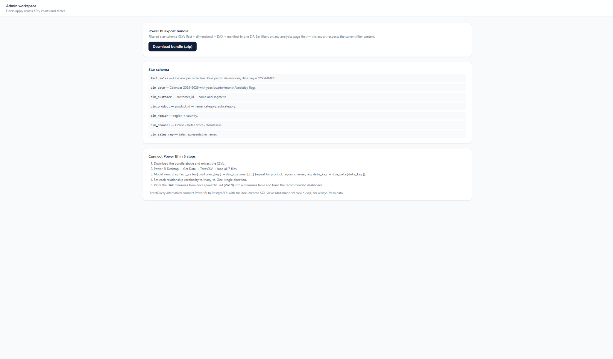

# InsightForge BI — End-to-End Retail Analytics Platform

**Live demo:** https://insightforge-web.onrender.com
(demo login `admin@insightforge.io` / `Admin123!`)

Upload CSV/XLSX sales data → validate & clean with Pandas → store in
PostgreSQL star schema → analyze with SQL → dashboards, executive insights
and Power BI-ready exports. Built with **Next.js 14 + FastAPI + PostgreSQL**.

## Features

- **Guided import wizard**: drag-drop upload, sheet picker, file preview,
  alias-assisted column mapping, validation (errors vs warnings), transparent
  cleaning with before/after examples, background confirm, completion summary
- **Analytics**: overview (9 KPIs + prev-period deltas), sales (+ baseline
  revenue forecast with backtest), profitability
  (discount-vs-margin, low-margin alerts), customers (CLV, new/returning,
  **RFM, cohort retention, declining**), products (leaders/laggards +
  drilldown), regions & channels, monthly **targets tracking** — all
  filterable (date, region, category, channel, segment, status…) with
  URL-synced filters; KPIs centralized in `kpi_catalog.py`, money as
  `Numeric(12,2)`
- **Executive insights**: 12 deterministic, traceable rules (trend, risk,
  opportunity, data quality, **target variance, forecast risk**) with
  configurable `INS_*` thresholds, evidence fields and dismiss — no black
  box, no external AI calls
- **Power BI**: filtered one-click ZIP (fact + dimensions + DAX + manifest
  with reconciliation totals), 18 DAX measures,
  star-schema docs, Import + DirectQuery guides
- **Imports**: append/upsert/replace modes, searchable history, formula-
  injection guard, quality filters + lineage in the data-quality report
- **Auth & RBAC**: admin / analyst / viewer demo accounts, JWT, audit logs

## Screenshots


*Overview dashboard — sign in as admin with 2025 selected*


*Data Imports mid-validation on the demo CSV*


*Executive Insights page*


*Power BI Desktop relationships view*

## Quickstart (Docker - Local)

```bash
cp .env.example .env
docker compose up --build
# frontend http://localhost:3000 · API docs http://localhost:8000/docs
```

## Production Hosting (Oracle Cloud Always Free)

Deploy to an Oracle Cloud Always Free VM (Ampere 4-core / 24GB or AMD Micro) with production Nginx reverse proxy:
```bash
# On your Oracle VM:
sudo bash scripts/setup-oracle-vm.sh
```
See the full guide in [docs/oracle-cloud-deployment.md](file:///f:/End-to-End%20Business%20Intelligence%20&%20Analytics%20Platform/docs/oracle-cloud-deployment.md).


## Quickstart (local, no Docker)

```powershell
Copy-Item .env.example .env
cd backend
pip install -r requirements.txt
python -m alembic upgrade head
python -m app.seeds.run
python -m uvicorn app.main:app --reload --port 8000
cd ..\frontend; npm install; npm run dev
```

Demo logins: `admin@insightforge.io / Admin123!`,
`analyst@insightforge.io / Analyst123!`, `viewer@insightforge.io / Viewer123!`

Generate + import demo data: `python demo-data/generate.py --rows 50000`
(see `docs/demo-data.md`), then Data Imports → upload the CSV.

## Project structure

```
frontend/  Next.js App Router (app/*, components/*, lib/*, hooks/*)
backend/   FastAPI (app/api, auth, ingestion, analytics, insights, exports, models, seeds)
database/  views/*.sql, dax/measures.dax, powerbi_model.md, README.md (migrations)
demo-data/ generate.py + sample CSV/XLSX
docs/      setup, architecture, schema, validation, analytics, api, powerbi,
           deployment, troubleshooting, security, limitations, future
```

## Commands

| Task | Command |
|---|---|
| Backend tests | `cd backend && python -m pytest tests/ -q` |
| Backend lint/format/typecheck | `cd backend && python -m ruff check app/ && python -m ruff format --check app/ && python -m mypy app/` |
| Frontend typecheck | `cd frontend && node ".\node_modules\typescript\bin\tsc" --noEmit` |
| Frontend lint/tests | `cd frontend && node ".\node_modules\next\dist\bin\next" lint --dir . && node ".\node_modules\vitest\vitest.mjs" run` |
| Migrate | `cd backend && python -m alembic upgrade head` |
| Seeds / reset+seed | `cd backend && python -m app.seeds.run [--reset]` |
| Demo data | `python demo-data/generate.py --rows 50000 --out demo-data` |
| CI | `.github/workflows/ci.yml` (backend + frontend jobs) |

## Docs index

`docs/setup.md` · `architecture.md` · `environment.md` · `roles.md` ·
`upload-schema.md` · `validation.md` · `analytics.md` · `api.md` ·
`powerbi.md` · `deployment.md` · `oracle-cloud-deployment.md` · `troubleshooting.md` · `security.md` ·
`limitations.md` · `future.md` — plus `database/README.md` (migrations) and
`database/powerbi_model.md` (star schema).
